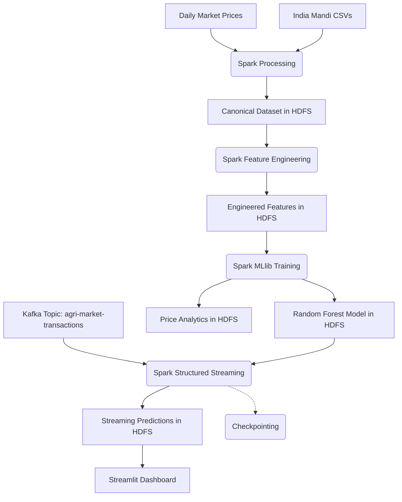

# Large-Scale Agricultural Market Data Processing and Real-Time Market Analysis

This repository contains the complete implementation of a big data analytics and real-time anomaly detection system built entirely from scratch. The system ingests 132.9M real agricultural records, cleans them, engineers features, performs large-scale price analysis, predicts anomalies using machine learning, and visualizes results in a real-time streaming dashboard.

## 🏗️ Complete Architecture



## 📊 Scale and Data Volume

The project strictly processes real agricultural data:
- **Real source records:** 132.9M
- **Canonical dataset:** 93.41M records
- **Real raw data volume:** ≈ 10.9 GB
- **Synthetic Scalability Workload:** ≈ 7.1 GB (Used exclusively for isolated scalability testing)
- **Total Experimental Workload:** ≈ 18 GB

## 📈 Price Analytics & Forecasting
The system provides comprehensive historical price analysis utilizing Spark DataFrames and Window functions. 
*(Note: Forecasting is strictly out-of-scope for the live dashboard unless actively validated models are deployed).*

## 🧠 Final ML Results

Model Selection was performed using a deterministic 1% entity-safe representative sample, evaluated on an untouched 2025+ temporal test set (52,303 records).

**Model Details:**
- **Model:** Spark MLlib Random Forest Classifier
- **Number of Trees:** 100
- **Max Depth:** 12
- **Max Bins:** 128
- **Instance Weighting (for Class Imbalance):** 1.2
- **Decision Threshold:** 0.50
- **Seed:** 42L

**Test Results (Untouched 2025+ Test Set):**
- **Accuracy:** **85.06%** (Beats trivial all-normal baseline of 84.35%)
- **Precision:** **61.48%**
- **False Positive Rate (FPR):** **1.41%** (Ultra-low false alarm rate)
- **Recall:** 12.11%
- **F1 Score:** 20.23%
- **PR-AUC:** 32.44%
- **ROC-AUC:** 67.83%

**Confusion Matrix (52,303 Unseen Test Records):**
- **True Negatives (TN):** 43,497
- **False Positives (FP):** 621
- **False Negatives (FN):** 7,194
- **True Positives (TP):** 991


## 📂 Distributed Storage (HDFS)

All data is reliably persisted in HDFS (1 NameNode + 3 DataNodes) with Replication Factor = 3:
- **Canonical Dataset:** `/agri/processed/canonical`
- **Engineered Features:** `/agri/features/engineered`
- **Trained Model:** `/agri/models/anomaly_prediction_rf`
- **Batch Analytics:** `/agri-market/analytics/`
- **Streaming Predictions Sink:** `/agri/streaming/real_anomaly_predictions`
- **Streaming Checkpoints:** `/agri/checkpoints/real_market_stream`

## 🚀 Real-Time Streaming Infrastructure

Kafka acts as the event transport mechanism (not a database).
- **Topic:** `agri-market-real-replay` (for real data replay)
- **Host Producer:** `localhost:9092`
- **Spark Structured Streaming Consumer:** `host.docker.internal:29092`

## 📊 Streamlit Dashboard

A lightweight, real-time PySpark + Streamlit dashboard reads directly from the streaming sink and batch analytics paths.
- **Title:** Large-Scale Agricultural Market Data & Real-Time Analysis
- **Startup Command (Using Docker):**
  ```bash
  docker build -f Dockerfile.dashboard -t agri-dashboard .
  docker run -d --name agri-dashboard --network docker_default -p 8501:8501 agri-dashboard
  ```
